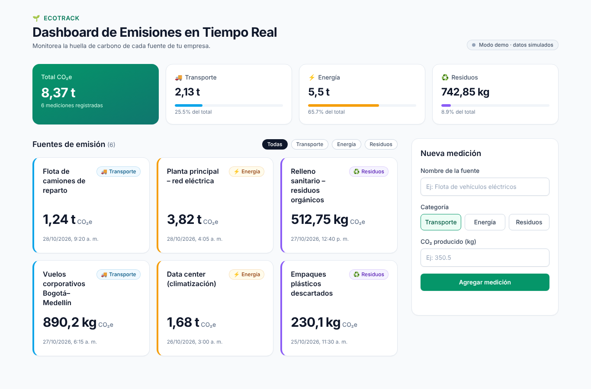

# 🌱 EcoTrack · Dashboard de Emisiones en Tiempo Real

Proyecto Integrador **"El Ciclo Spec-to-Code en Acción"**.
Componente `EmissionsTracker` construido con **React 18 + Vite + TypeScript (strict) + Tailwind CSS + Supabase**, desarrollado mediante prompteo iterativo con IA.



## 📦 Entregables

| Entregable | Ubicación |
|---|---|
| Bitácora de prompts (4 prompts + evolución del código) | [`docs/BITACORA_PROMPTS.md`](docs/BITACORA_PROMPTS.md) |
| Componente principal | [`src/components/EmissionsTracker.tsx`](src/components/EmissionsTracker.tsx) |
| Custom hook | [`src/hooks/useEmissions.ts`](src/hooks/useEmissions.ts) |
| Configuración de Supabase | [`src/lib/supabaseClient.ts`](src/lib/supabaseClient.ts), [`supabase/schema.sql`](supabase/schema.sql) |
| Capturas de la demostración | [`docs/capturas/`](docs/capturas) |

## ✨ Funcionalidades

- **Tarjetas** con nombre de la fuente, categoría (Transporte / Energía / Residuos) y CO₂ producido.
- **Formulario** para agregar mediciones con validación y mensajes accesibles.
- **Custom hook `useEmissions`**: carga, inserción, borrado, `loading`, errores y suscripción **Realtime** de Supabase.
- **Resumen** con total de CO₂e y porcentaje por categoría.
- **Filtro** por categoría.
- **Optimistic UI** con rollback automático si el servidor falla.
- **Feedback claro**: skeletons, spinner, estado vacío, alertas de error con "Reintentar".
- **Responsive** (móvil, tablet, escritorio) y **accesible** (ARIA, foco visible, lectores de pantalla).
- **Modo demo**: si no configuras Supabase, funciona con datos simulados.

## 🗂️ Estructura del proyecto

```
ecotrack-emissions/
├── docs/
│   ├── BITACORA_PROMPTS.md        # Bitácora del ciclo Spec-to-Code
│   └── capturas/                  # Capturas de todos los estados de la UI
├── supabase/
│   ├── schema.sql                 # Tabla, constraints, RLS y Realtime
│   └── seed.sql                   # Datos de ejemplo
├── src/
│   ├── components/
│   │   ├── EmissionsTracker.tsx   # Contenedor principal (solo UI)
│   │   ├── EmissionCard.tsx       # Tarjeta (React.memo)
│   │   ├── EmissionCardSkeleton.tsx
│   │   ├── EmissionForm.tsx       # Formulario con validación
│   │   ├── EmissionsSummary.tsx   # Totales por categoría
│   │   ├── Alert.tsx              # Mensajes de error accesibles
│   │   ├── Spinner.tsx
│   │   └── categoryStyles.ts      # Colores/iconos y formateadores
│   ├── hooks/
│   │   └── useEmissions.ts        # Lógica de estado (useReducer + useMemo)
│   ├── lib/
│   │   ├── supabaseClient.ts      # Cliente Supabase
│   │   └── emissionsRepository.ts # Capa de datos: Supabase o demo
│   ├── types/
│   │   └── emissions.ts           # Tipos de dominio
│   ├── App.tsx
│   ├── main.tsx
│   └── index.css
├── .env.example
├── index.html
├── package.json
├── tailwind.config.js
├── tsconfig.json
└── vite.config.ts
```

### Arquitectura

```
EmissionsTracker (UI)  →  useEmissions (estado)  →  EmissionsRepository (datos)  →  Supabase | Demo
```

La UI no conoce Supabase; el hook no conoce la UI; el repositorio se inyecta, lo que permite cambiar la fuente de datos o hacer tests sin red.

## 🚀 Cómo ejecutarlo

```bash
npm install
npm run dev        # http://localhost:5173
```

Sin configuración adicional la app corre en **modo demo** (tip: escribe una fuente que contenga la palabra "error" para ver el manejo de errores).

### Conectar a Supabase (opcional)

1. Crea un proyecto en [supabase.com](https://supabase.com).
2. En **SQL Editor** ejecuta `supabase/schema.sql` (y opcionalmente `supabase/seed.sql`).
3. Copia `.env.example` a `.env.local` y completa `VITE_SUPABASE_URL` y `VITE_SUPABASE_ANON_KEY` (Project Settings → API).
4. Reinicia `npm run dev`. El indicador cambiará a "Conectado a Supabase · tiempo real".

### Otros comandos

```bash
npm run build      # Typecheck + build de producción
npm run preview    # Sirve el build
```

## 📸 Capturas

| Estado | Captura |
|---|---|
| Cargando (skeleton) | `docs/capturas/01-cargando-skeleton.png` |
| Dashboard escritorio | `docs/capturas/02-dashboard-desktop.png` |
| Validación del formulario | `docs/capturas/03-validacion-formulario.png` |
| Guardando (optimistic UI) | `docs/capturas/04-guardando-optimista.png` |
| Medición agregada | `docs/capturas/05-medicion-agregada.png` |
| Error del servidor + rollback | `docs/capturas/06-error-servidor.png` |
| Filtro por categoría | `docs/capturas/07-filtro-categoria.png` |
| Vista móvil | `docs/capturas/08-responsive-movil.png` |
